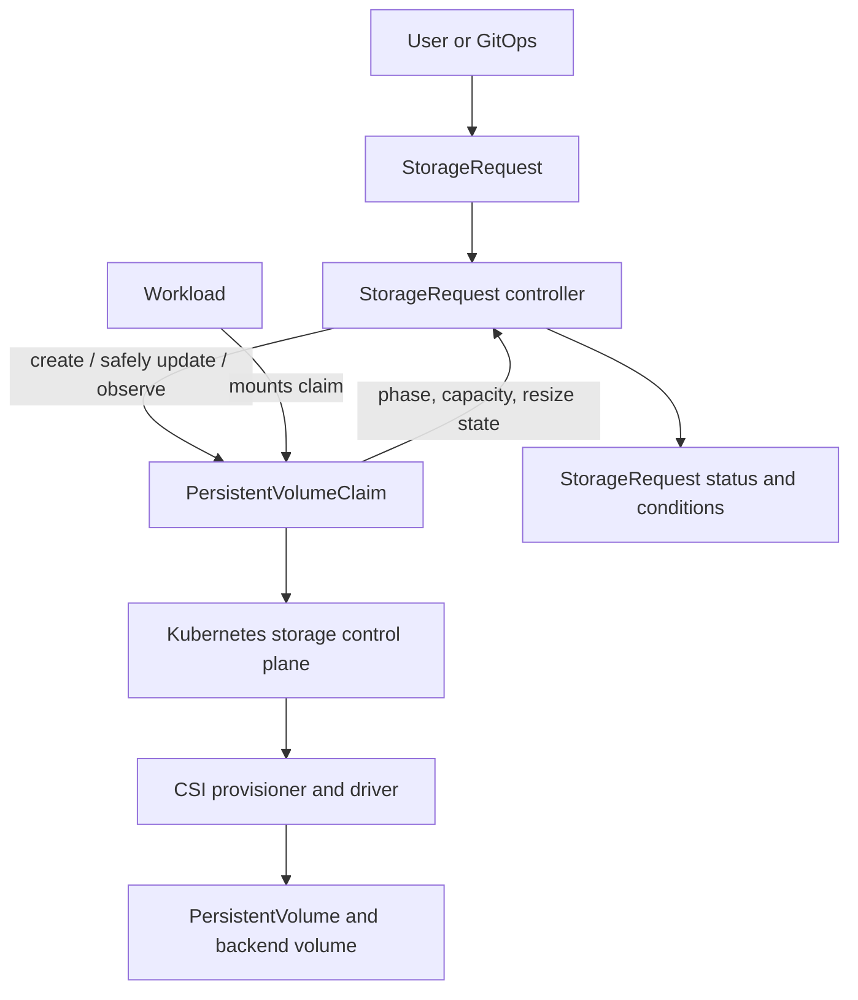

# StorageRequest Operator

A Kubernetes Operator that manages one `PersistentVolumeClaim` (PVC) for each namespaced `StorageRequest`, with ownership-safe reconciliation, capacity expansion, lifecycle status, and explicit retention behavior.

> **Project status:** Under active implementation against the approved v1alpha1 design. Milestones 1–7 are complete (scaffold, API, PVC creation/identity, watches/status/events, safe updates/resize, Retain/Delete finalization, and deployment hardening); see the roadmap below. CSI-backed end-to-end tests and the release steps (milestone 8) remain, so the operator is not yet production-ready: run it only against a disposable test cluster until milestone 8 and the release checklist are complete.

## What it does

A user creates a `StorageRequest`. The operator creates and observes a same-namespace PVC with the same name, reports the claim lifecycle through status conditions, supports supported capacity expansion, and applies the selected PVC retention policy when the request is deleted.

The operator is an orchestration layer over Kubernetes storage APIs. **It does not provision storage itself.** Kubernetes storage controllers and the installed CSI driver perform provisioning, binding, attachment, mounting, and backend-specific operations.

## Design contract

The authoritative design is [`docs/design.md`](docs/design.md) — **Kubernetes StorageRequest Operator, v1.1**. It is the implementation contract for API shape, reconciliation, ownership, resize behavior, finalization, RBAC, testing, and acceptance criteria.

Key safety rules:

- One `StorageRequest` manages one PVC in the same namespace, with the same name.
- The PVC has no owner reference to the `StorageRequest`; a finalizer implements the explicit deletion policy.
- A PVC is never adopted based on its name alone. The request UID annotation and recorded PVC UID must match.
- A previously observed PVC that disappears is reported as missing; the operator does not silently create an empty replacement.
- The operator never reduces actual volume capacity. A lower pending resize target is allowed only for the narrowly defined terminal failed-resize recovery case.
- Immutable claim fields do not trigger automatic PVC replacement or migration.
- `Retain` is the default. `Delete` deletes the PVC, after which the PV reclaim policy determines backend cleanup.
- No PV, Pod, Node, Secret, `VolumeAttachment`, CSI socket, or vendor API management is in v1 scope.

## Architecture



See [`docs/architecture.md`](docs/architecture.md) for component boundaries, reconciliation flow, and lifecycle behavior.

## API preview

> The API group is `storage.base-domain.io`, using a domain controlled by the project. It is fixed for v1alpha1: changing an installed API group is a breaking migration, so it must not be repurposed.

```yaml
apiVersion: storage.base-domain.io/v1alpha1
kind: StorageRequest
metadata:
  name: app-data
  namespace: demo
spec:
  storage:
    size: 20Gi
    storageClassName: fast-ssd
    accessModes:
      - ReadWriteOnce
    volumeMode: Filesystem
  lifecycle:
    onDelete: Retain
```

The API details and status semantics are documented in [`docs/api.md`](docs/api.md) and normatively in [`docs/design.md`](docs/design.md).

## Project roadmap

| Milestone | Deliverable | State |
|---|---|---|
| 1 | Kubebuilder scaffold, manager, CRD generation | Complete |
| 2 | API types, defaults, validation, sample manifest | Complete |
| 3 | PVC builder, finalizer-before-create, identity and collision handling | Complete |
| 4 | PVC watches, status conditions, events | Complete |
| 5 | Immutable-field checks, expansion and failed-resize recovery | Complete |
| 6 | Retain/Delete finalization | Complete |
| 7 | RBAC, leader election, probes, metrics, hardening | Complete |
| 8 | CSI-backed E2E tests, user guide, operational troubleshooting | Not started |

The detailed task breakdown is in [`docs/implementation-plan.md`](docs/implementation-plan.md). The project is not production-ready until all acceptance criteria in the design and release checklist pass.

## Compatibility target

- Kubernetes **1.29+** is the design baseline.
- An OpenShift release is supported only after its bundled Kubernetes API and CSI stack pass the project's test matrix.
- CSI driver capabilities remain authoritative for access modes, provisioning, and volume expansion.

The supported platform matrix is a release gate and must be filled in before publishing a production release.

## Documentation

- [Approved design v1.1](docs/design.md) — authoritative implementation contract
- [Architecture](docs/architecture.md) — control flow and component responsibilities
- [API reference](docs/api.md) — spec, status, conditions, and mutability
- [Implementation plan](docs/implementation-plan.md) — milestones and engineering tasks
- [Development guide](docs/development.md) — toolchain versions and local checks
- [Testing strategy](docs/testing-strategy.md) — unit, envtest, and CSI-backed E2E
- [Operational safety](docs/operational-safety.md) — ownership, resize, and deletion safeguards
- [Release checklist](docs/release-checklist.md) — gates before shared-cluster or production use
- [Repository setup](docs/repository-setup.md) — proposed GitHub metadata and settings

## Contributing

See [`CONTRIBUTING.md`](CONTRIBUTING.md). All behavior changes must preserve the v1.1 safety contract or update the design through an explicit reviewed decision before implementation changes land.

## Security

Please do not report security vulnerabilities in public issues. Follow [`SECURITY.md`](SECURITY.md) for private reporting guidance.

## License

A license has not yet been selected. The repository owner must choose and add a license before accepting external contributions or publishing the project as open source. See the license decision in [`docs/repository-setup.md`](docs/repository-setup.md).
