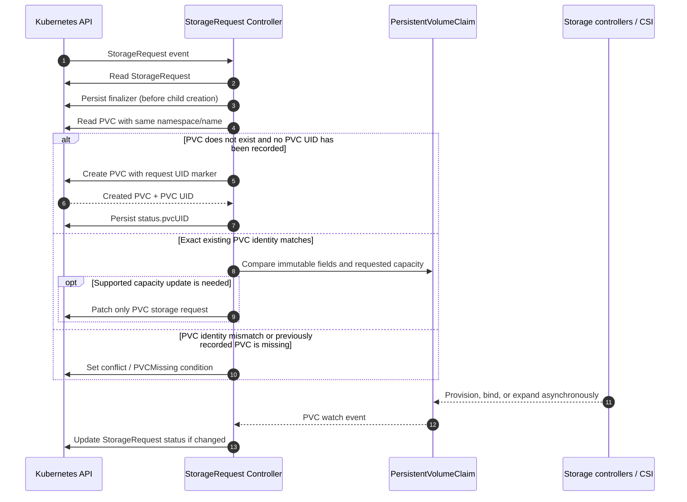
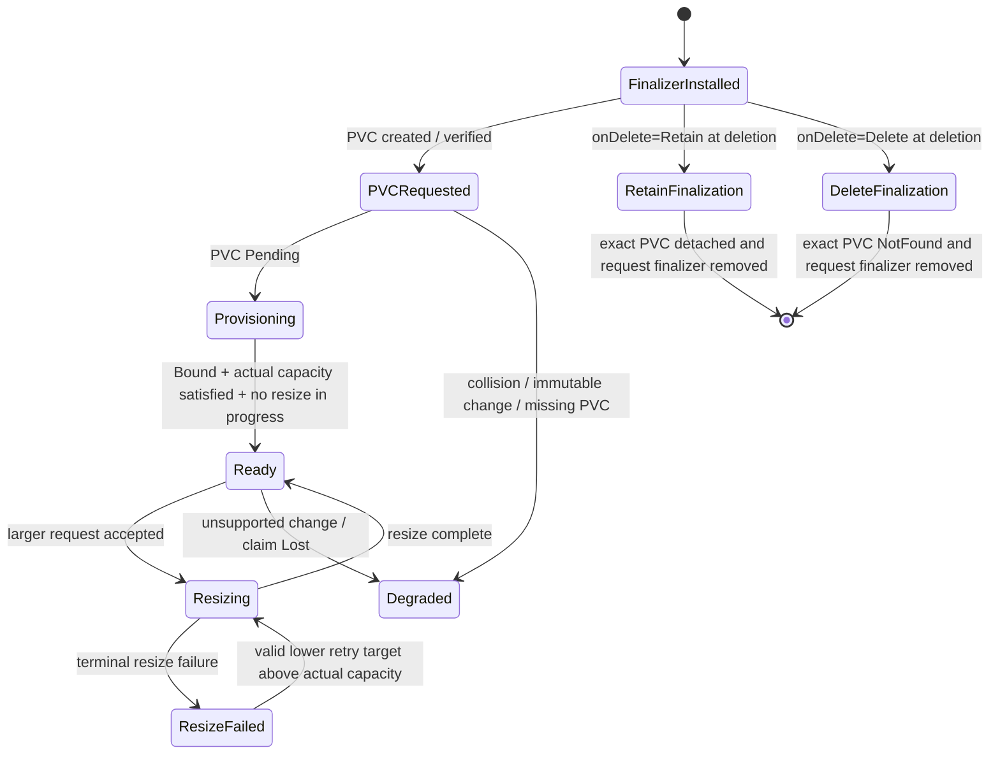

# Architecture

This document summarizes the architecture approved in [the v1.1 design](design.md). If a summary here differs from the design contract, `docs/design.md` is authoritative.

## Responsibility boundary

| Component | Responsibility |
|---|---|
| User / GitOps | Creates and updates namespaced `StorageRequest` resources. |
| StorageRequest controller | Validates intent, creates and observes the corresponding PVC, performs permitted PVC request updates, writes status, and finalizes deletion. |
| Kubernetes storage controllers | Match claims to PVs and coordinate provisioning and binding. |
| CSI provisioner / driver | Creates and manages backend storage. |
| Workload | Mounts and uses the PVC. |
| Cluster administrator | Installs CSI drivers and StorageClasses and configures quotas and storage policy. |

The operator does not manage PVs, Pods, Nodes, `VolumeAttachment` objects, CSI sockets, or vendor APIs.

## Main reconciliation sequence

## Object identity

The request-to-child relationship is protected by two identifiers:

1. `storage.base-domain.io/request-uid` on the PVC must equal the current `StorageRequest.metadata.uid`.
2. Once observed, `StorageRequest.status.pvcUID` records the PVC object's UID. The recorded UID must continue to match the object.

A name match is insufficient. An absent or mismatched marker is never permission to adopt, mutate, or delete a PVC. These metadata checks are not a cryptographic security boundary; RBAC must prevent unauthorized users from forging the marker or modifying managed PVC metadata.

## Reconciliation guarantees

- Persist the request finalizer before creating a PVC.
- Create a PVC only if it has never been observed/recorded for this request.
- Persist the created PVC UID immediately after creation and recover safely if the status write fails.
- Never recreate a previously recorded PVC after it disappears.
- Never replace a PVC to satisfy immutable field changes.
- Use quantity-aware comparisons and narrow patches.
- Keep reconcile operations short; provisioning and resizing happen asynchronously in Kubernetes/CSI.
- Watch PVC updates and map them back to the request by namespace and name, then re-verify identity during reconciliation.
- Keep status writes idempotent and avoid writing unchanged conditions.

## Lifecycle state overview

The state diagram is explanatory; use the condition definitions and finalization algorithm in `design.md` as the normative behavior.
