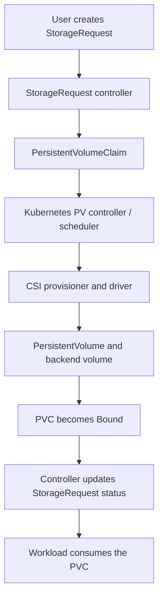

# Design Document: Kubernetes StorageRequest Operator

**Status:** Approved for implementation (v1alpha1)  
**Document version:** 1.1  
**API group/version:** `storage.base-domain.io/v1alpha1`  
**Implementation language/framework:** Go, Kubebuilder, controller-runtime  
**Target platforms:** Kubernetes 1.29+; OpenShift releases whose bundled Kubernetes API is 1.29+ and are included in the project test matrix  
**Last updated:** 2026-11-09

> **API group:** the API group is `storage.base-domain.io`, using a domain controlled by the project. Changing the API group after consumers create resources is a breaking migration, so this group is fixed for v1alpha1 and must not be repurposed.

> **Review disposition:** The design is approved to start implementation against this v1alpha1 contract. This is not a production deployment certification. A production release still requires the API-domain decision, an explicit Kubernetes/OpenShift support matrix, deployment/RBAC review, and passing CSI-backed end-to-end tests for every supported storage backend.

> **Compatibility baseline:** Kubernetes 1.29+ is the minimum design baseline. This provides stable `ReadWriteOncePod` semantics and supports the Kubernetes CEL quantity library used by the CRD validation. An OpenShift release is supported only after the same behavior is verified against its bundled Kubernetes version and CSI stack. Driver capability remains authoritative for access modes and expansion.

## 1. Executive summary

This document proposes a small, production-minded Kubernetes Operator that manages the lifecycle of one PersistentVolumeClaim (PVC) for each `StorageRequest` custom resource.

A user declares the desired storage configuration in a `StorageRequest`. The operator creates and observes a PVC in the same namespace, reports its lifecycle through Kubernetes status conditions, supports safe capacity increases, and applies an explicit retention policy when the custom resource is deleted.

The operator **does not provision storage itself**. Kubernetes' persistent-volume controllers and the cluster's CSI driver remain responsible for binding, dynamic provisioning, attachment, mounting, and backend-specific operations. The operator is an orchestration layer over the Kubernetes storage API, not a replacement for it.

### Design decision

| Concern | Decision |
|---|---|
| Custom resource | Namespaced `StorageRequest` |
| Managed resource | Exactly one PVC per `StorageRequest` |
| PVC name | Same as the `StorageRequest` name, in the same namespace |
| Provisioning | Kubernetes StorageClass and CSI provisioner |
| Supported lifecycle updates | Increase requested capacity; observe provisioning and resize progress |
| Shrinking | Never shrink actual volume capacity; only the failed, unfulfilled resize target may be lowered under the documented recovery rule |
| Deletion behavior | `Retain` by default; optional `Delete` |
| Ownership | Request UID annotation, managed label, and a recorded PVC UID; no owner reference |
| Missing child resource | Once the PVC UID has been recorded, a missing PVC is reported as degraded and is not recreated automatically |
| Resize recovery | Never shrink actual capacity; permit reducing only a failed, unfulfilled resize target when the new target remains above observed capacity |
| Deletion policy updates | `onDelete` may be changed while the request is active; the value at deletion time controls finalization |
| Persistence of state | Kubernetes API objects only; no local state or external database |
| Initial scope | PVC lifecycle only; no workloads, snapshots, backups, or CSI implementation |

## 2. Goals and non-goals

### 2.1 Goals

1. Provide a clear declarative API for requesting persistent storage.
2. Create one PVC from each valid request and let the platform provision it.
3. Report whether the claim is pending, bound, resizing, or degraded.
4. Permit safe capacity growth when the StorageClass supports expansion, and support recovery from a terminally failed expansion without shrinking the actual volume.
5. Prevent accidental adoption, mutation, recreation, or deletion of an unrelated or previously managed PVC.
6. Make deletion behavior explicit and safe by default.
7. Remain idempotent and recover correctly after restarts, retries, leader changes, or temporary API failures.
8. Be testable without requiring a real storage backend for every unit or integration test.

### 2.2 Non-goals for the first version

- Creating or managing PersistentVolumes directly.
- Implementing, configuring, or replacing a CSI driver or external provisioner.
- Managing Pods, Deployments, StatefulSets, or application mount configuration.
- Snapshot, clone, backup, restore, replication, encryption, or disaster-recovery workflows.
- Cross-namespace claims or sharing a single claim between multiple `StorageRequest` objects.
- Automatic migration between StorageClasses or access modes.
- Actual volume shrinking, filesystem shrinking, or online filesystem repair. Lowering a failed, unfulfilled resize target under section 6.4 is permitted because it does not reduce actual volume capacity.
- Managing backend-specific storage arrays, cloud disks, credentials, or vendor APIs.

These are separate capabilities with their own lifecycle and data-loss risks. They should only be added through explicit future API proposals.

## 3. Core Kubernetes storage model

The operator works with the following control-plane flow:



A PVC is a request for storage, while a PV represents the provisioned storage resource. A StorageClass describes the provisioner and storage policy used to satisfy a claim. The Kubernetes storage control plane and CSI implementation perform the actual provisioning and binding. See the Kubernetes [Persistent Volumes](https://kubernetes.io/docs/concepts/storage/persistent-volumes/) and [Storage Classes](https://kubernetes.io/docs/concepts/storage/storage-classes/) documentation.

### 3.1 Responsibility boundary

| Component | Responsibility |
|---|---|
| User / GitOps | Creates and updates `StorageRequest` |
| StorageRequest Operator | Validates intent, creates/updates the PVC, observes it, reports status, handles request deletion |
| Kubernetes storage controllers | Match claims to PVs and coordinate provisioning/binding |
| CSI provisioner / driver | Create and manage storage using the storage backend |
| Application workload | Mounts and uses the PVC |
| Cluster administrator | Installs CSI drivers and StorageClasses; defines quotas and storage policy |

The operator must not patch PV capacity, manipulate `VolumeAttachment` objects, mount devices, access CSI sockets, or call vendor APIs in this design.

## 4. API design

### 4.1 Custom resource definition

**Kind:** `StorageRequest`  
**Scope:** Namespaced  
**Plural:** `storagerequests`  
**Version:** `v1alpha1`  
**Status subresource:** Enabled

A `StorageRequest` represents one storage claim. Its name is also the PVC name. This makes the relationship easy to discover and avoids a second naming field that could drift.

### 4.2 Example resource

```yaml
apiVersion: storage.base-domain.io/v1alpha1
kind: StorageRequest
metadata:
  name: app-data
  namespace: demo
spec:
  storage:
    size: 20Gi
    storageClassName: fast-ssd
    accessModes:
      - ReadWriteOnce
    volumeMode: Filesystem
  lifecycle:
    onDelete: Retain
```

The resulting PVC is expected to look similar to:

```yaml
apiVersion: v1
kind: PersistentVolumeClaim
metadata:
  name: app-data
  namespace: demo
  labels:
    app.kubernetes.io/managed-by: storage-request-operator
    storage.base-domain.io/managed: "true"
  annotations:
    storage.base-domain.io/request-uid: "<StorageRequest UID>"
spec:
  accessModes:
    - ReadWriteOnce
  volumeMode: Filesystem
  storageClassName: fast-ssd
  resources:
    requests:
      storage: 20Gi
```

The operator adds the UID annotation at creation time. The value shown above is illustrative; the operator must use the actual `StorageRequest.metadata.uid`.

### 4.3 Spec fields

| Field | Type | Required | Default | Mutability / behavior |
|---|---|---:|---|---|
| `spec.storage.size` | Kubernetes quantity | Yes | None | Must be a valid positive quantity. May increase. A reduction is rejected except when lowering a terminally failed, unfulfilled expansion target to a value still greater than the PVC's observed capacity; this does not shrink the volume. |
| `spec.storage.storageClassName` | string | No | Omitted | If omitted, omit the PVC field and allow Kubernetes defaulting. If supplied, it must match the existing PVC class after creation; no migration is performed. Empty string is rejected, so explicitly requesting a classless PVC is not supported in v1. |
| `spec.storage.accessModes` | list of access modes | No | `[ReadWriteOnce]` | Immutable after PVC creation. The selected driver/backend must support the requested mode. |
| `spec.storage.volumeMode` | `Filesystem` or `Block` | No | `Filesystem` | Immutable after PVC creation. |
| `spec.lifecycle.onDelete` | `Retain` or `Delete` | No | `Retain` | Mutable while the `StorageRequest` is active. The value present when deletion is requested controls finalization. Switching to `Delete` is explicitly destructive and must be governed by namespace RBAC/GitOps review. |

Supported access mode values should match the Kubernetes API: `ReadWriteOnce`, `ReadOnlyMany`, `ReadWriteMany`, and `ReadWriteOncePod`. `ReadWriteOncePod` requires a sufficiently recent Kubernetes version (stable from Kubernetes 1.29). Driver support and topology constraints still apply; accepting a value in the CRD does not guarantee that a cluster can satisfy it.

**StorageClass defaulting rule:** The operator must not guess the cluster's default StorageClass. It omits `spec.storageClassName` on the PVC when the field is omitted from the custom resource and lets Kubernetes apply its defaulting behavior. Kubernetes 1.28+ can retroactively assign a default StorageClass to an existing PVC whose `storageClassName` is unset when a default later becomes available. Therefore, omission means “use the cluster default whenever Kubernetes assigns one”; it does not guarantee a permanently classless claim. Once a non-empty class is assigned, a later change to the cluster default does not migrate that claim. The PVC's observed class is authoritative when the custom resource omits the field. If a class is later supplied explicitly, it must match the PVC's current class or the request is reported as an immutable-field change. Explicitly requesting no class (`storageClassName: ""`) is intentionally unsupported in v1.

### 4.4 Status fields

Suggested status structure:

```yaml
status:
  observedGeneration: 1
  pvcName: app-data
  pvcUID: 01234567-89ab-cdef-0123-456789abcdef
  pvcPhase: Bound
  volumeName: pvc-01234567-89ab-cdef-0123-456789abcdef
  capacity: 20Gi
  conditions:
    - type: Ready
      status: "True"
      reason: Bound
      message: PersistentVolumeClaim app-data is bound and has the requested capacity.
      observedGeneration: 1
      lastTransitionTime: "2026-11-09T12:00:00Z"
    - type: Degraded
      status: "False"
      reason: AsExpected
      message: No storage request errors detected.
      observedGeneration: 1
      lastTransitionTime: "2026-11-09T12:00:00Z"
```

Recommended fields:

- `observedGeneration`: spec generation last processed by the controller.
- `pvcName`: name of the managed PVC; included for convenient tooling even though it equals the custom resource name.
- `pvcUID`: UID of the exact PVC object incarnation first verified as belonging to this request. Once set, it is not cleared during the request's lifetime and is used to detect deletion/recreation or same-name replacement.
- `finalizationPolicy`: the `onDelete` value captured on the first finalization reconcile. It is immutable once set and is how the deletion-time policy is frozen (see section 7.4): because CRD CEL cannot read `metadata.deletionTimestamp`, the freeze is carried by this status field rather than a transition rule on `onDelete`.
- `pvcPhase`: current PVC phase (`Pending`, `Bound`, or `Lost`) when a PVC exists. Omit it when the PVC is absent; absence is represented by a condition, not a fabricated PVC phase.
- `volumeName`: bound PV name, when assigned.
- `capacity`: actual capacity currently reported by the PVC status, when available; this is not the requested size.
- `conditions`: standard `metav1.Condition` values.

`Ready=True` means the claim is `Bound`, its reported actual capacity is at least the requested size, and Kubernetes reports no resize operation still pending/in progress. Evaluate PVC resize conditions and `status.allocatedResourceStatuses["storage"]` where that field is served. `Ready=False` while provisioning, while resize is pending/in progress, or when actual capacity is below the requested size. Terminal resize failure is surfaced through `Degraded=True` with reason `ResizeFailed`. A `Lost` claim has `Ready=False`, reason `VolumeLost`. A missing previously-created claim has `Ready=False`, reason `PVCMissing`.

A request that asks for a smaller size than an already provisioned PVC may remain usable: `Ready` can stay `True` when actual capacity still satisfies the request, while `Degraded=True` explains that PVC shrink is unsupported and the existing claim was left unchanged.

### 4.5 API validation rules

Enforce validation in the CRD schema and retain defensive validation in Go before making any PVC change:

- `spec.storage.size` is required and must be a valid, positive Kubernetes quantity. On the Kubernetes 1.29+ baseline, use the CEL quantity library in the CRD and repeat the check with `resource.Quantity.Sign` in Go. Use `resource.Quantity.Cmp` for comparisons of validated sizes; never use strings or floating-point arithmetic for comparisons. The implemented rule is `type(self) == int ? self > 0 : (self.size() <= 64 && !self.matches('[eE][+-]?[0-9]{3,}') && isQuantity(self) && quantity(self).compareTo(quantity('0')) > 0)`. Three points are deliberate deviations from the earlier example `quantity(self).sign() > 0`: (1) `sign` is registered as a global function in the API server's CEL library, so the method form fails to compile at CRD creation, and `compareTo(quantity('0'))` is used instead; (2) the length and exponent guards come first because quantity parsing and comparison are superlinear in the decimal exponent, so an unguarded rule lets a value such as `1e2147483647` exhaust API server CPU and memory; (3) the field is int-or-string, so integers are handled in their own branch. The Go validation mirrors the bound with a constant-time magnitude check before any `Cmp`.
- `storageClassName`, when present, must be non-empty. Omission means “use the cluster's defaulting behavior,” not “request no StorageClass.”
- `accessModes` must contain at least one supported Kubernetes access mode and must not contain duplicates (`minItems: 1`, enum values, and `x-kubernetes-list-type: set`; CRD schemas forbid `uniqueItems: true`).
- `volumeMode` is limited to `Filesystem` or `Block`; default it to `Filesystem`.
- `status.pvcUID` is immutable once set (section 4.4). A root-level CEL transition rule rejects changing it, clearing it, or removing the whole status.
- `onDelete` is limited to `Retain` or `Delete`; default it to `Retain`.
- Reject unknown fields through the CRD's structural schema. Do not add arbitrary PVC templates or pass-through fields in v1.

A validating admission webhook is not required for the v1 quantity-positive check on the stated Kubernetes baseline. Keep controller-side validation as defense in depth. The controller must never create or resize a PVC from an invalid or non-positive quantity.

The `Degraded` condition is `True` for actionable, persistent problems such as a PVC name collision, ownership mismatch, immutable-field change, or unsupported shrink/expansion request. It is `False` when no such problem remains. Transient API errors should normally be returned from `Reconcile` for controller-runtime retry rather than persisted as a permanent degraded state.

Use stable, machine-readable condition reasons. Suggested reasons include:

- `Provisioning`
- `Bound`
- `Resizing`
- `VolumeLost`
- `PVCNameConflict`
- `OwnershipMismatch`
- `ImmutableFieldChange`
- `ShrinkNotSupported`
- `ExpansionNotSupported`
- `StorageClassNotFound`
- `ResizeRecoveryRejected`
- `PVCMissing`
- `PVCDeleting`
- `ResizeFailed`

Do not use status as a second source of truth. The PVC remains authoritative for claim phase and capacity; the custom resource status is a user-friendly summary.

## 5. Resource identity and ownership

### 5.1 Identity markers

The PVC must carry:

- Label `app.kubernetes.io/managed-by=storage-request-operator`.
- Label `storage.base-domain.io/managed=true`.
- Annotation `storage.base-domain.io/request-uid=<StorageRequest UID>`.

The request UID annotation is the request-to-PVC identity marker. Names alone are not sufficient because a `StorageRequest` can be deleted and recreated with the same name but a different UID. The controller also records the PVC object's own UID in `StorageRequest.status.pvcUID`; this detects a same-name PVC replacement after the original claim has been observed. These markers protect against accidental collisions and stale reconciliation, but they are not a cryptographic authorization boundary: namespace RBAC must prevent unauthorized users from forging or modifying managed PVC metadata.

### 5.2 No owner reference

The PVC intentionally has **no owner reference** to the `StorageRequest`.

An owner reference would allow Kubernetes garbage collection to delete the PVC independently of the operator's explicit retention policy. The operator instead uses a finalizer to carry out the selected cleanup behavior. This avoids relying on implicit garbage-collection behavior for a data-bearing resource.

### 5.3 Existing PVC collision rules

When a PVC with the expected name already exists:

1. If its `storage.base-domain.io/request-uid` annotation equals the current request UID and `status.pvcUID` is empty, treat it as recovery of a PVC created before a controller restart/status-write failure; record the PVC UID before continuing.
2. If the annotation is absent or contains another UID, the operator must not adopt, patch, relabel, or delete it.
3. If `status.pvcUID` is already set and differs from the PVC's UID, treat it as a replacement/collision even if the request annotation was copied; do not adopt or mutate it.
4. If the request UID annotation and recorded PVC UID both match, the PVC is the exact managed claim and may be reconciled. Operator-owned labels may be repaired only after both identity checks pass.
5. On any mismatch, set `Degraded=True`, reason `PVCNameConflict` or `OwnershipMismatch`, and emit a warning event.

There is no automatic adoption feature in v1. Adoption of existing claims would need a separate, explicit design and authorization model.

## 6. Reconciliation design

### 6.1 Controller behavior

The controller follows the Kubernetes declarative control-loop model: read the custom resource and current PVC state, calculate the required change, make the smallest safe API update, and report observed state. A reconcile operation must be idempotent.

High-level algorithm:

```text
Reconcile(namespace, name):
  1. Read StorageRequest.
     - If NotFound: return success.
  2. If deletionTimestamp is set:
     - If our finalizer is absent: return success.
     - Execute the finalization flow in section 7.
     - Remove our finalizer only when finalization is complete.
     - Return.
  3. Ensure our finalizer exists.
     - Persist it and return; do not create the PVC before this succeeds.
  4. Read PVC with the same namespace/name.
     - If NotFound and status.pvcUID is empty: create the desired PVC with identity markers; persist the returned PVC UID in status before returning.
     - If NotFound and status.pvcUID is set: set Ready=False / Degraded=True, reason PVCMissing; do not recreate a data-bearing claim automatically.
     - If another request owns it, or its UID differs from the recorded pvcUID: set a conflict condition; do not mutate it.
     - If the request UID annotation matches and status.pvcUID is empty: record the observed PVC UID (recovery after a crash between PVC creation and status persistence).
     - If the PVC has a deletionTimestamp while its request is active: report PVCDeleting and do not create a replacement.
  5. Compare immutable fields.
     - On a mismatch, set Degraded=True and do not mutate/recreate the PVC.
  6. Compare requested size with PVC spec request.
     - Larger: run the resize checks and update only the storage request.
     - Equal: no spec update.
     - Smaller: allow only the failed-resize recovery exception in section 6.4; otherwise set Degraded=True and do not shrink the actual volume.
  7. Read the PVC phase, capacity, volume name, and resize conditions.
  8. Update StorageRequest status only if it changed.
  9. Return success; rely on PVC watch events and a bounded requeue for progress.
```

### 6.2 Creation behavior

The controller must add and persist its finalizer before creating a PVC. If finalizer persistence fails, it must not create the PVC. This closes the race where a request could be deleted before the operator has installed its cleanup hook.

PVC creation must be deterministic and include only fields owned by the operator. Do not copy arbitrary user-provided annotations or labels from the custom resource to the PVC.

If the create call returns `AlreadyExists`, re-read the PVC and apply the ownership and PVC-UID checks from section 5.3. Never interpret `AlreadyExists` as permission to adopt the object. After a successful create, persist the returned PVC UID to `StorageRequest.status.pvcUID` immediately; if that status write fails, return the error and recover by reading the still-existing PVC on the next reconcile. Once `pvcUID` is recorded, a later `NotFound` is a degraded missing-claim condition, not a create instruction. Kubernetes does not provide an atomic transaction across the request and PVC objects, so the controller must keep the post-create UID write adjacent to creation and test restart/recovery behavior explicitly.

### 6.3 Immutable fields

After PVC creation, the following are immutable from the operator API's perspective:

- `storageClassName`
- `accessModes`
- `volumeMode`

If the user changes one of these fields, the operator must not delete and recreate the PVC to make the spec appear satisfied. It should set `Degraded=True`, reason `ImmutableFieldChange`, explain the field that differs, and preserve the existing claim and its data.

A future storage migration feature should use a separate resource or explicit migration workflow, not implicit replacement.

### 6.4 Capacity expansion and failed-resize recovery

The operator never shrinks the actual volume. Normal capacity updates are grow-only. Kubernetes also supports recovery from a terminally failed expansion by lowering the *unfulfilled requested target*, provided the new request remains greater than the PVC's actual reported capacity. The operator must support this narrow recovery path rather than permanently locking the claim at an impossible target.

For a bound PVC, compare quantities with `resource.Quantity.Cmp` and apply these rules:

1. **Requested size greater than the PVC request:** resolve the PVC's actual `storageClassName` and read that StorageClass. Require `allowVolumeExpansion: true`. If the class is missing, absent, or disallows expansion, do not patch the PVC; report `StorageClassNotFound` or `ExpansionNotSupported`. Otherwise patch only `PVC.spec.resources.requests.storage` to the larger quantity.
2. **Requested size equal to the PVC request:** no resize patch is needed; observe status and resize progress.
3. **Requested size smaller than the PVC request:** permit this only as failed-expansion recovery when PVC status explicitly reports a terminal storage resize failure (`ControllerResizeFailed` or `NodeResizeFailed` in `status.allocatedResourceStatuses["storage"]`), the PVC has an observed actual capacity, and the new request is strictly greater than that actual capacity. The StorageClass must still allow expansion. Patch only the PVC request to the lower target; this changes the pending target, not the actual volume size.
4. For every other decrease (including an unbound claim, a resize still in progress, missing actual capacity, a target equal to/below actual capacity, or no explicit terminal failure), do not patch the PVC. Set `Degraded=True`, reason `ShrinkNotSupported` or `ResizeRecoveryRejected`. Never reduce the request below observed actual capacity.
5. Do not patch PV capacity or PVC status. The Kubernetes storage control plane and CSI driver own those fields.

For an unbound PVC, a larger requested size is deferred rather than applied immediately: Kubernetes forbids changing `spec.resources.requests` on an unbound PVC (it reports that the spec is immutable except for `resources.requests` and `volumeAttributesClassName` on a *bound* claim), and the operator must never delete and recreate the claim to force the larger size. The operator therefore records the intent, leaves the claim untouched, and applies the increase on the first reconcile after the claim binds — at which point the bound-claim rules above apply, including the `allowVolumeExpansion` check. A decrease remains rejected in v1; the recovery exception applies only to a bound PVC with a terminally failed expansion and a known actual capacity.

After submitting an expansion, report `Ready=False`, reason `Resizing`, until the PVC remains `Bound`, `status.capacity.storage` is at least the requested size, and no resize operation remains pending/in progress. Inspect PVC conditions and `status.allocatedResourceStatuses["storage"]` where served. A terminal controller/node resize failure sets `Degraded=True`, reason `ResizeFailed`, with the PVC's actionable details surfaced in the message/event. Do not continuously re-patch the same failed target; wait for a spec change or an explicit recovery target.

Kubernetes permits volume expansion only when the StorageClass sets `allowVolumeExpansion: true` and the provisioner/driver supports it. It does not shrink the actual volume. A lower retry target must remain above the actual PVC capacity. See [Persistent Volumes: expansion and recovery](https://kubernetes.io/docs/concepts/storage/persistent-volumes/#expanding-persistent-volume-claims).

### 6.5 PVC status and watch behavior

The controller must observe PVC changes even though PVCs are not owner-referenced to the custom resource.

Recommended controller-runtime setup:

- Primary watch: `StorageRequest` objects.
- Secondary watch: PVC objects carrying `storage.base-domain.io/managed=true`.
- Mapping: enqueue a `StorageRequest` in the PVC's namespace with the same name.
- Predicate: process relevant create, update, and delete events when either the old or new PVC carries the managed label/request-UID annotation. In particular, do not filter out label-removal or deletion-timestamp transitions needed for finalization and missing-claim detection.
- Safety check: reconcile verifies both the PVC request UID annotation and the recorded `status.pvcUID` (when present) before taking action.

A PVC update can signal binding, resize completion, loss, deletion, or a storage-controller condition change. Avoid a broad PVC event loop by ensuring status updates are written only when values or conditions actually change. A modest periodic requeue (for example, 30 seconds) is a fallback for missed events, not the primary progress mechanism.

Do not filter out deletion-timestamp changes or finalizer-related updates on the primary resource. If predicates are introduced, test that delete/finalize paths still enqueue.

## 7. Deletion and data-retention behavior

Deletion is the most sensitive part of this operator. It must be explicit, idempotent, and observable.

The controller uses a finalizer such as `storage.base-domain.io/finalizer`. Kubernetes keeps an object with a finalizer in a terminating state until the responsible controller completes its cleanup and removes the finalizer. See the Kubernetes [Finalizers](https://kubernetes.io/docs/concepts/overview/working-with-objects/finalizers/) documentation.

### 7.1 `onDelete: Retain` (default)

When the custom resource is deleted:

1. Read the PVC by namespace/name.
2. Verify its request UID annotation matches the deleting custom resource UID. If `status.pvcUID` is set, also require an exact PVC UID match. If the annotation matches but `status.pvcUID` is empty (the create/status-write recovery case), the observed PVC may be treated as the request's claim.
3. If identity matches, mark it as retained/orphaned using an annotation such as `storage.base-domain.io/orphaned-from=<request UID>` and remove the active `storage.base-domain.io/managed` label so it is no longer reconciled as an active request.
4. Do not delete the PVC.
5. Remove the custom resource finalizer.

The PVC and its bound PV remain available. The user/operator is responsible for the retained claim after the `StorageRequest` is gone.

If the PVC is absent, finalization is already complete. If a same-named PVC exists but has a different or missing request UID, or its UID differs from the recorded `status.pvcUID`, do not modify it; log and emit an event, then complete `Retain` finalization because this request cannot prove ownership. If the PVC already has a deletion timestamp because another actor requested its deletion, `Retain` cannot cancel that API operation; emit a warning event explaining that the claim is already terminating, then complete finalization without claiming that the PVC was retained. A retained PVC is detached from active reconciliation by removing the `storage.base-domain.io/managed` label and adding the orphan annotation.

### 7.2 `onDelete: Delete`

When the custom resource is deleted:

1. Read the PVC by namespace/name.
2. If absent, finalization is complete.
3. Verify the request UID annotation matches the deleting custom resource UID. If `status.pvcUID` is set, also require an exact PVC UID match. If the status UID is empty but the request UID annotation matches, use the observed PVC UID as the recovery identity.
4. Delete the PVC using a UID precondition based on the PVC UID read by the controller. Never issue the delete if either available identity check fails.
5. Reconcile again until the PVC is actually `NotFound`.
6. Remove the custom resource finalizer only after the PVC is gone.

If the PVC is still in use, Kubernetes PVC protection may delay its deletion. The operator must wait rather than bypassing protection or deleting consuming Pods. Workloads must be stopped or detached through their own lifecycle before the claim can disappear.

If the PVC exists but ownership cannot be proven, set an event/log indicating `OwnershipMismatch` and keep the `StorageRequest` finalizer rather than risk deleting another user's data. This intentionally favors data safety over automatic deletion. The operator must expose enough information for an administrator to resolve the conflict. If the PVC already has a deletion timestamp and both identity checks match, continue waiting for `NotFound`; do not remove or bypass Kubernetes protection finalizers.

### 7.3 Important distinction: deleting a PVC is not the same as retaining backend data

`StorageRequest.spec.lifecycle.onDelete` controls whether this operator retains or deletes the **PVC**. It does not override the PersistentVolume reclaim policy.

When a PVC is deleted, the backing PV behavior depends on its reclaim policy. A dynamically provisioned PV commonly inherits `Delete` or `Retain` from its StorageClass; a `Delete` reclaim policy can cause the storage asset itself to be deleted. Therefore:

- `onDelete: Retain` means the operator leaves the PVC in place.
- `onDelete: Delete` means the operator deletes the PVC; the PV reclaim policy then determines backend cleanup.

Never describe `onDelete: Delete` as a guaranteed backend deletion or `onDelete: Retain` as a backup. Retention is not backup, and no snapshot is taken by this operator.

### 7.4 Finalizer failure policy

- Retry transient Kubernetes API failures with controller-runtime's rate-limited work queue.
- Never remove the finalizer before the selected action is complete.
- Never ignore UID mismatches.
- Never remove another controller's finalizers.
- Do not provide a normal-operation "force cleanup" switch.
- Document manual finalizer removal only as an administrator recovery procedure after the PVC/data implications have been understood and handled.
- `onDelete` is mutable only while the request is active. Once deletionTimestamp is set, the deletion-time policy is fixed and finalization must use that value; do not attempt to change the policy during finalization. This freeze is enforced through `status.finalizationPolicy`: the first finalization reconcile records the current `onDelete` into that immutable field, and every later reconcile finalizes from the recorded value, so a concurrent change to `spec.lifecycle.onDelete` during the terminating window (for example GitOps self-heal) cannot redirect finalization. A validating admission webhook would freeze `onDelete` directly and may be added as later hardening; it is intentionally avoided in v1 (section 4.5).

## 8. Error handling and recovery

| Scenario | Required behavior |
|---|---|
| StorageRequest not found | No-op; return success |
| During normal reconciliation, PVC does not exist and `status.pvcUID` is empty | Treat as initial creation; create the PVC and persist its UID immediately |
| PVC does not exist and `status.pvcUID` is set | `Ready=False`, `Degraded=True`, reason `PVCMissing`; do not recreate automatically |
| PVC create race (`AlreadyExists`) | Re-read and verify UID ownership |
| Existing PVC has no request UID | Report conflict; do not adopt or mutate |
| Existing PVC belongs to another request UID | Report ownership mismatch; do not mutate/delete |
| PVC `Pending` | `Ready=False`, reason `Provisioning`; continue observing |
| PVC `Bound` | Report PV name and actual capacity; set Ready based on requested capacity |
| PVC `Lost` | `Ready=False`, reason `VolumeLost`; do not recreate automatically |
| PVC has a deletion timestamp while its request is active | `Ready=False`, `Degraded=True`, reason `PVCDeleting`; do not create a replacement or mutate the terminating claim |
| PVC name matches but PVC UID differs from recorded status | `Degraded=True`, reason `OwnershipMismatch`; do not adopt, patch, or delete it |
| StorageClass missing during expansion | Do not patch claim; report actionable condition |
| Terminal PVC resize failure | `Ready=False` if actual capacity is below target; `Degraded=True`, reason `ResizeFailed`; allow only the documented lower-target recovery when it remains above actual capacity |
| StorageClass disallows expansion | Do not patch claim; report unsupported expansion |
| User decreases requested size | Do not shrink actual capacity; report `ShrinkNotSupported` unless the failed-resize recovery exception applies |
| User changes immutable field | Do not recreate; report `ImmutableFieldChange` |
| PVC deletion is delayed by protection | Keep finalizer and wait |
| API conflict / timeout / throttling | Return error or bounded retry; re-read latest object before retrying |
| Operator restarts during finalization | Re-read state and repeat idempotently |

Do not create a replacement PVC automatically when a claim becomes `Lost` or when a previously recorded PVC UID is no longer present. The operator cannot know whether data is recoverable or whether a replacement would mask a storage incident. For `PVCMissing`, an administrator must inspect the PV/backend reclaim outcome. If a fresh, empty volume is desired, delete the old request after reviewing the retention implications and create a new `StorageRequest` with a different name; v1 has no in-place reset of `status.pvcUID` and no automatic recovery/adoption workflow.

## 9. Implementation architecture

### 9.1 Suggested project layout

```text
storage-request-operator/
├── api/
│   └── v1alpha1/
│       ├── storagerequest_types.go
│       └── groupversion_info.go
├── internal/
│   ├── controller/
│   │   └── storagerequest_controller.go
│   ├── storage/
│   │   ├── pvc_builder.go
│   │   ├── pvc_validation.go
│   │   └── resize.go
│   └── conditions/
│       └── conditions.go
├── config/
│   ├── crd/
│   ├── rbac/
│   ├── manager/
│   └── samples/
│       └── storage_v1alpha1_storagerequest.yaml
├── docs/
│   └── design.md
├── Makefile
├── PROJECT
└── go.mod
```

Keep PVC construction, immutability checks, resize checks, and condition updates in small functions. Avoid putting all logic into a large `Reconcile` method.

### 9.2 Controller-runtime responsibilities

- Use a cached client for reads and the controller-runtime client for writes.
- Use context-aware API calls; do not use `context.Background()` inside reconcile helpers.
- Use patch operations for narrow updates, especially PVC capacity and metadata markers.
- Persist `status.pvcUID` immediately after PVC creation and whenever recovering an existing PVC whose request UID matches and whose recorded PVC UID is empty.
- Use optimistic concurrency and re-read on conflicts; never blindly overwrite a newer object.
- Compare status before writing it to avoid unnecessary status events and reconcile loops.
- Use `resource.Quantity.Cmp` for all quantity comparisons.
- Keep reconcile operations short. Never wait synchronously for CSI provisioning or volume expansion.
- Enable leader election for multi-replica deployments.
- Use a bounded periodic requeue for states that may not produce a watch event.

### 9.3 Status update discipline

Use the status subresource and standard `metav1.Condition` helpers. Set `observedGeneration` to the generation actually processed. Preserve transition times when a condition's status/reason/message has not materially changed. A status update should not change the desired spec or PVC spec.

### 9.4 Events and logs

Emit Kubernetes Events for meaningful transitions and user-actionable failures, not every reconcile:

- `PVCRequested`
- `PVCBound`
- `PVCResizing`
- `PVCNameConflict`
- `ImmutableFieldChange`
- `ExpansionNotSupported`
- `StorageRetained`
- `PVCDeletionRequested`
- `PVCMissing`
- `PVCDeleting`
- `ResizeFailed`

Use structured logs with namespace, request name, request UID, generation, PVC name, and outcome. Avoid logging secrets or backend credentials (none should be handled in this design).

## 10. RBAC and security

### 10.1 Operator permissions

The controller needs the minimum permissions required for its responsibilities:

| Resource | Verbs | Reason |
|---|---|---|
| `storagerequests` | `get`, `list`, `watch`, `patch` | Read requests and maintain finalizers |
| `storagerequests/status` | `get`, `patch` | Publish status |
| `persistentvolumeclaims` | `get`, `list`, `watch`, `create`, `patch`, `delete` | Create, observe, resize, mark, and delete only the corresponding PVC |
| `storageclasses` | `get` | Check `allowVolumeExpansion` before a bound-claim resize |
| `events` | `create`, `patch` | Publish user-visible Kubernetes Events |

The controller writes requests and their status only through optimistic-lock merge patches, so `update` is not granted on either resource; this keeps the role at the least privilege the design requires.

The operator does **not** need permissions to create/update/delete PVs, Pods, Nodes, Secrets, `VolumeAttachment` objects, or CSI resources for this design.

The exact ClusterRole/Role split depends on installation scope. For a controller restricted to one namespace, prefer namespace-scoped RoleBindings for namespaced resources. Reading StorageClasses requires cluster-scoped `get` permission because StorageClasses are cluster-scoped.

### 10.2 Tenant and storage policy

The operator's service account can create PVCs on behalf of users. Therefore, permission to create a `StorageRequest` is effectively permission to request storage within the limits available to the operator.

Production deployments should:

- Grant `StorageRequest` write permissions only to users/workloads allowed to consume storage in that namespace.
- Apply `ResourceQuota` for PVC count and requested storage.
- Use `LimitRange` where appropriate.
- Restrict available StorageClasses through admission policy or a deployment-level allowlist when tenants must not select every class.
- Treat StorageClass names and access modes as policy-sensitive inputs.
- Run the controller as non-root, with a read-only root filesystem where practical, and without host mounts or CSI socket access.
- Use TLS for metrics endpoints and restrict metrics access to monitoring components.

The operator must not accept arbitrary PVC annotations, volume attributes, secrets, or backend parameters from the custom resource in v1.

## 11. Availability, scaling, and operations

- Run at least one replica; use controller-runtime leader election when running multiple replicas.
- Use readiness and liveness probes supplied by the manager.
- Expose controller-runtime metrics and health endpoints through secured Services/NetworkPolicies.
- Set CPU/memory requests and limits based on measured reconcile load.
- Configure graceful termination so the active reconcile can stop cleanly; correctness must not depend on completing a reconcile before shutdown because all actions are idempotent.
- Scope caches and watches to the namespaces the operator is authorized to manage where possible.
- Do not hold in-memory state between reconciles. A restarted or newly elected leader must recover entirely from Kubernetes API objects.

### 11.1 Suggested metrics

Use controller-runtime's standard reconcile metrics and add a small number of low-cardinality metrics if operationally useful:

- Reconcile outcomes by result/reason (not by namespace/name).
- Count of requests in degraded state.
- Count of PVCs currently provisioning/resizing, if derived safely from observed objects.
- Finalization failures by reason.

Do not use request names, PVC names, UIDs, or namespaces as Prometheus labels; that creates high-cardinality metrics. Put object identity in logs and Events instead.

## 12. Testing strategy

Storage behavior must be tested at multiple levels. A fake Kubernetes client cannot validate a real CSI driver's behavior, so the test plan separates controller correctness from backend integration.

### 12.1 Unit tests

Test pure helper functions and controller decisions:

- PVC builder sets the expected namespace/name, access modes, volume mode, class, size, labels, and request UID annotation.
- Omitted StorageClass remains omitted on initial PVC creation; the controller accepts Kubernetes retroactive default assignment without treating it as drift.
- A same-name PVC with a different or missing request UID is never adopted.
- A PVC UID is recorded and a same-name replacement with a different PVC UID is never adopted.
- A missing PVC after its UID is recorded is reported and is not recreated automatically.
- Immutable field changes are detected and do not mutate the PVC.
- Quantity comparisons work for equivalent formats (for example, `1Gi` and `1024Mi`).
- Capacity growth is accepted; equal size is a no-op; shrink is rejected.
- Expansion is rejected if the StorageClass does not allow it.
- Failed-expansion recovery can lower only the unfulfilled target, and only to a value strictly greater than actual capacity.
- A pending/in-progress resize and a terminal resize failure produce the correct Ready/Degraded conditions.
- Ready remains false while PVC resize status/conditions indicate pending or in-progress work, even if the requested target has been submitted.
- Ready/Degraded semantics are correct for Pending, Bound, Lost, missing, deleting, and resizing states.
- Retain finalization annotates and detaches the PVC without deleting it when it is not already terminating.
- Retain finalization emits a warning when the PVC already has a deletion timestamp; it must not claim that a terminating PVC was retained.
- Delete finalization checks request UID and recorded PVC UID (when present), uses a UID precondition, and waits until the claim is absent.
- Repeated finalization is safe and idempotent.

### 12.2 API and controller integration tests

Use `envtest` with the generated CRD and API server to verify:

- CRD schema validation and defaults.
- Status subresource behavior.
- Finalizer persistence and deletion timestamps.
- PVC create/update/delete API interactions.
- Conflict/retry behavior and watch-to-request mapping.

`envtest` does not provide a CSI driver or a real volume provisioner. Tests must not claim to prove successful storage provisioning or mounting.

### 12.3 End-to-end tests

Run against a cluster with a working CSI provisioner and a disposable StorageClass:

1. Create a `StorageRequest`; verify a PVC is created.
2. Verify the PVC transitions to `Bound` and the custom resource becomes `Ready=True`.
3. Mount the PVC from a test Pod and write/read a marker file (Filesystem mode).
4. Increase the requested size where the test StorageClass supports expansion; verify PVC request and reported capacity converge.
5. Verify an ordinary shrink request is rejected without changing PVC size; verify a terminally failed expansion can be retried with a lower target that remains above actual capacity.
6. Delete a request with `onDelete: Retain`; verify the PVC remains and is detached from active reconciliation when it was not already terminating.
7. Delete a request with `onDelete: Delete`; verify the PVC is removed after consumers stop.
8. Run delete tests with both `Delete` and `Retain` PV reclaim policies only in an isolated test environment, and verify the backend implications explicitly.
9. Restart the operator during provisioning, resizing, and deletion; verify it converges without duplicated or destructive actions.

Use disposable namespaces and test storage only. Never run destructive reclaim-policy tests against production data.

### 12.4 Minimum acceptance criteria

The implementation is not complete until all of the following are true:

- [ ] A valid `StorageRequest` creates exactly one PVC in the same namespace.
- [ ] The PVC is never created before the request finalizer is persisted.
- [ ] The controller never adopts a PVC without a matching request UID and, once recorded, a matching PVC UID.
- [ ] A PVC missing after its UID is recorded is not recreated automatically.
- [ ] Pending and Bound states are reflected accurately in status.
- [ ] A bound PVC can be expanded only when its StorageClass supports expansion; a larger requested size on a still-unbound claim is deferred (Kubernetes forbids the request change before bind) and applied on the first reconcile after the claim binds.
- [ ] Actual volume capacity is never reduced; a lower failed-resize target is accepted only when it remains strictly above actual capacity and Kubernetes reports a terminal resize failure.
- [ ] Ready remains false while Kubernetes reports resize work pending/in progress or actual capacity is below the desired target.
- [ ] StorageClass, access mode, and volume mode changes do not trigger PVC replacement.
- [ ] `Retain` leaves a non-terminating, exactly-owned PVC intact after request deletion; if another actor has already initiated PVC deletion, the operator emits a warning and does not falsely report retention.
- [ ] `Delete` removes only the PVC owned by that exact request UID and waits for deletion to complete.
- [ ] PVC reclaim-policy consequences are documented and tested separately.
- [ ] Controller restart and repeated reconcile operations are safe.
- [ ] RBAC grants no PV, Pod, Node, Secret, or CSI-resource access for the v1 scope.
- [ ] Unit, envtest, and CSI-backed end-to-end tests pass.

## 13. Implementation milestones

| Milestone | Deliverable | Exit criteria |
|---|---|---|
| 1. Scaffold | Kubebuilder project, API group, manager, CRD generation | Project builds; CRD installs |
| 2. API | `StorageRequestSpec`, status, defaults, validation, sample YAML | Schema/default tests pass |
| 3. PVC creation | Builder, identity markers, finalizer-before-create, PVC UID persistence, collision/missing-claim handling | Creation, restart recovery, and ownership tests pass |
| 4. Status and watches | PVC watch mapping, conditions, events, observed generation | Pending/Bound/Lost status tests pass |
| 5. Safe updates | Immutable field checks, capacity growth, failed-expansion target recovery, resize status mapping | Grow-only, recovery-boundary, readiness, and unsupported-expansion tests pass |
| 6. Finalization | Retain/Delete flows and UID-preconditioned delete | All deletion and restart tests pass |
| 7. Hardening | RBAC, leader election, probes, metrics, security defaults | Static checks and deployment review pass |
| 8. E2E and docs | CSI-backed tests, user guide, operational troubleshooting | Acceptance criteria complete |

## 14. Operational examples

Create a request:

```bash
kubectl apply -f config/samples/storage_v1alpha1_storagerequest.yaml
```

Inspect request and claim:

```bash
kubectl get storagerequests -n demo
kubectl describe storagerequest app-data -n demo
kubectl get pvc app-data -n demo
kubectl describe pvc app-data -n demo
```

Request a capacity increase by changing `spec.storage.size` to a larger quantity and applying the manifest. Do not reduce it as a normal operation. The only supported lower target is the documented recovery path after a terminal expansion failure, and the new target must remain strictly above the PVC's actual reported capacity.

Retain storage on request deletion (default):

```bash
kubectl delete storagerequest app-data -n demo
kubectl get pvc app-data -n demo
```

Delete the PVC on request deletion:

```yaml
spec:
  lifecycle:
    onDelete: Delete
```

Before choosing `Delete`, ensure no workload is using the PVC and understand the PV reclaim policy of the selected StorageClass.

## 15. Risks and mitigations

| Risk | Mitigation |
|---|---|
| Accidental data deletion | Retain default; explicit Delete; finalizer; request UID verification; PVC UID delete precondition |
| Claim adoption by name collision | No auto-adoption; require matching request UID annotation |
| Attempted capacity shrink | Never reduce actual capacity; reject ordinary request reductions and allow only the explicit failed-resize target-recovery case |
| Unsupported expansion | Check StorageClass `allowVolumeExpansion`; surface a stable condition |
| CSI provisioning failure | Surface PVC phase/events; do not implement backend-specific retries or create replacement claims |
| Operator outage during deletion | Finalizer preserves the request; cleanup is idempotent and resumes after restart |
| Reconcile storms | Status no-op checks, narrow PVC watch predicates that preserve deletion/label-removal events, bounded fallback requeue |
| Tenant storage abuse | Namespace RBAC, ResourceQuota, admission policy, optional StorageClass allowlist |
| Backend deletion misunderstood | Document PVC deletion separately from PV reclaim policy; test both reclaim policies |
| PVC manually deleted or replaced | Record the PVC UID; report missing/replaced claims and do not silently provision an empty replacement |
| Resize target exceeds backend limits | Surface terminal resize failures; permit only Kubernetes-supported recovery to a lower pending target above actual capacity |
| API evolution breaks users | Version the CRD deliberately; add fields compatibly; do not repurpose existing field semantics |

## 16. Future extensions (separate design proposals)

Potential future capabilities include:

- `VolumeSnapshot` integration for point-in-time snapshots and restore workflows.
- Backup/restore integration with a platform backup product.
- Explicit PVC migration to another StorageClass using a staged copy workflow.
- `VolumeAttributesClass` support where the target Kubernetes and CSI driver support it.
- Optional workload templates or a separate higher-level application resource that consumes the claim.
- Admission policies or a centrally managed StorageProfile API for tenant-safe class selection.

Each extension must specify API compatibility, RBAC, failure recovery, data-loss behavior, and test coverage before implementation.

## 17. Resolved design questions and release gates

The following decisions are now part of the v1alpha1 contract; they are not implementation-time choices:

| Question | Decision |
|---|---|
| What happens if a managed PVC disappears while its request remains? | Once `status.pvcUID` is recorded, report `PVCMissing` and do not recreate a new volume automatically. An administrator must explicitly resolve the request. |
| How is a PVC replacement with the same name detected? | Verify the request UID annotation and the recorded PVC object's UID. A mismatch is never adopted, patched, or deleted. |
| Can users change `onDelete`? | Yes, while the `StorageRequest` is active. The value at deletion time is authoritative. `Delete` is destructive and must be controlled through RBAC/GitOps review. |
| Can a failed resize target be reduced? | Yes, only when Kubernetes reports a terminal resize failure and the new target is strictly greater than the PVC's actual reported capacity. This changes the pending target; it never shrinks the volume. |
| What does `Ready=True` mean? | The PVC is Bound, actual capacity meets the requested target, and no resize operation is reported as pending/in progress. |
| What if no default StorageClass exists when the PVC is created? | Leave the field omitted. Kubernetes may assign a default retroactively when one later becomes available. The operator accepts that API-server change and does not migrate a claim itself. |
| Is an admission webhook required for positive quantity validation? | No for the Kubernetes 1.29+ baseline: use CRD CEL quantity validation and repeat the validation in Go. |
| What is the minimum platform baseline? | Kubernetes 1.29+. OpenShift releases must meet the same bundled Kubernetes API baseline and pass the operator's CSI-backed test matrix. |

The API-group selection gate is resolved: the group is `storage.base-domain.io`, a domain controlled by the project. It is fixed for v1alpha1; changing an installed API group is a breaking migration, so it must not be repurposed.

### Approval boundary

This document is approved as the implementation contract for v1alpha1. The approval covers the API shape, controller lifecycle, ownership checks, resize contract, deletion policy, and test requirements. It does not claim that every CSI backend supports every access mode or expansion workflow, and it does not authorize production rollout before the acceptance criteria and platform-specific end-to-end tests pass.

## 18. References

- [Kubernetes Operator pattern](https://kubernetes.io/docs/concepts/extend-kubernetes/operator/)
- [Kubernetes Custom Resources](https://kubernetes.io/docs/concepts/extend-kubernetes/api-extension/custom-resources/)
- [Kubernetes Persistent Volumes](https://kubernetes.io/docs/concepts/storage/persistent-volumes/)
- [Kubernetes Storage Classes](https://kubernetes.io/docs/concepts/storage/storage-classes/)
- [Kubernetes CEL quantity library](https://kubernetes.io/docs/reference/using-api/cel/#kubernetes-quantity-library)
- [Kubernetes CRD validation rules](https://kubernetes.io/docs/tasks/extend-kubernetes/custom-resources/custom-resource-definitions/#validation-rules)
- [Kubernetes Finalizers](https://kubernetes.io/docs/concepts/overview/working-with-objects/finalizers/)
- [Kubebuilder: Using Finalizers](https://book.kubebuilder.io/reference/using-finalizers.html)
- [Kubebuilder: Predicates and Watches](https://kubebuilder.io/reference/watching-resources/predicates-with-watch)

---

**Summary of the safety contract:** this operator creates and manages a PVC, never a PV or backend volume directly; it never silently adopts an unrelated claim, never reduces actual volume capacity, never automatically replaces a previously observed missing claim, and never deletes a PVC unless the user selected `onDelete: Delete` and both available identity checks (request UID annotation and recorded PVC UID) match the deleting custom resource.
